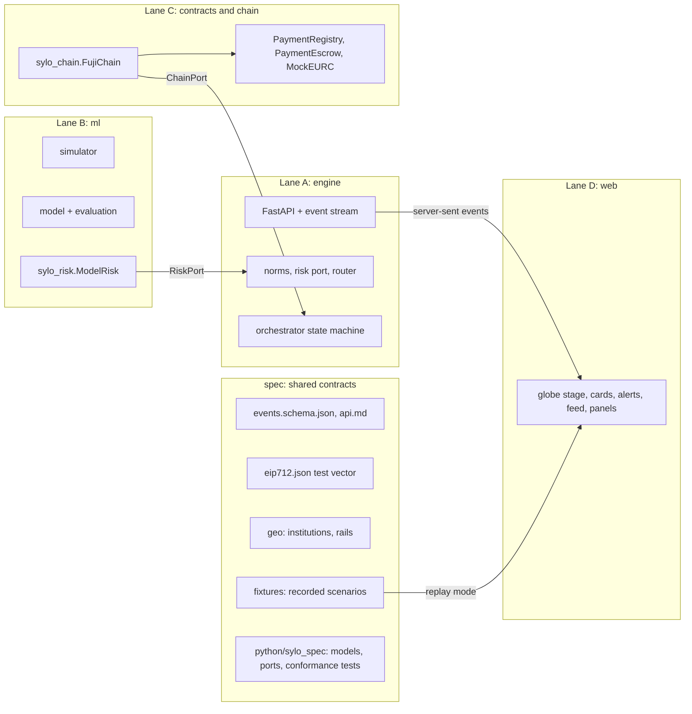

# Sylo.ai — project context for agents and teammates

> Read this first. It explains what Sylo.ai is, what we are building this weekend, how the code is organised, and the rules every contributor (human or agent) must follow.
> Related documents: [`roadmap-and-lanes.md`](./roadmap-and-lanes.md) (who does what in each version) · [`v0-build-spec.md`](./v0-build-spec.md) (exact spec of the first version) · [`setup.md`](./setup.md) (tools, MCPs, wallets, keys) · [`../prd-final-v4.md`](../prd-final-v4.md) (full product requirements) · [`../prd-merge-recap.md`](../prd-merge-recap.md) (how the four team PRDs were merged).

---

## 1. The event and the constraint

- **Hackathon:** Secure Horizons, ESSEC Cergy, 10–11 October 2026.
- **Track:** **Track 1 — Fintech Security: Guardians of Value.** Judged on detection effectiveness (30%), response quality (20%), feasibility and technical integration (20%), compliance and explainability (15%), pitch and demo (15%).
- **Code freeze:** Sunday 11 October, 12:00 (jury at 13:00; to confirm with organisers).
- **Team:** four people working in four lanes (A, B, C, D), described in §7.
- **Rules of the hackathon:** synthetic data only, no action on real systems, no secrets in the repository.

## 2. The product in one paragraph

Sylo.ai is a decision and control layer that sits above licensed payment rails (banks, payment providers, licensed crypto-asset service providers). It holds no money. For every cross-border business payment, **before any money moves**, it (1) keeps only the routes that are legal in both countries, (2) scores the fraud risk with signals that no single institution sees alone, (3) picks the cheapest and fastest of the remaining safe routes, (4) seals the approved payment on-chain as a signed EIP-712 record, and (5) acts in proportion to the risk: execute, hold the money in an escrow smart contract until the supplier confirms on a known contact, pause for an analyst, or block and report. Every step is provable.

**Promise:** "The cheapest compliant route when everything is fine. A window to stop the money when something is wrong."

## 3. The north star experience

A **3D animated globe** fills the screen. Each payment appears at the centre as a card and travels across the globe as a **comet**, hop by hop, along the route Sylo.ai chose (the optimal one). Illegal routes flash and disappear when the norms are checked. The stablecoin hop rises as a **higher arc**, because it travels through a public blockchain rather than through a country. **If fraud appears, the comet stops in place** (on the escrow lock, mid-route) and an **alert explains** what was detected, what is protecting the money, and what happens next. If the supplier says the account is not theirs, the comet **flies back** to the payer: the money is refunded. If someone tries to cheat the smart contract, the attempt **fails visibly** with a link to the public explorer. A text feed next to the globe tells the same story for anyone who cannot see the animation.

## 4. The scenario we handle end to end

One scenario, handled perfectly from first signal to final report (the brief asks for exactly that):

**Supplier-payment diversion (business email compromise) on a France → Ghana goods payment, and the mule network behind it.**

- **Payer:** Rhône Cosmétiques SAS, Lyon (Claire, CFO; Marc, second approver).
- **Supplier:** Savanna Shea Exports Ltd, Tamale, Ghana; nominated bank account in Accra; known contact Kwame Asante.
- **Invoice:** SSE-2026-118, **EUR 85,000**, shea butter (goods).
- **Scene 1 — legit payment:** route R3 (euro stablecoin on Avalanche via licensed providers) is chosen, the mobile-wallet route R4 is excluded by Ghana's export-proceeds rule, risk is LOW, the payment is sealed on-chain and credited.
- **Scene 2 — diverted invoice:** an email from a look-alike domain asks to pay a new account ("K. MENSAH VENTURES", opened 9 days ago in Aflao near the Togo border). Risk is MEDIUM: the money goes into escrow, Kwame is asked on his known number (after a SIM-swap check), he says no, the analyst confirms, the payment is revoked on-chain and refunded.
- **Scene 2b — the jury tries to cheat:** release the revoked payment, swap the beneficiary in transit, replay or edit a decision. All fail, visibly.
- **Later scenes (v2):** the mule network lights up on the globe and a regional circuit breaker protects other payments; a rail outage triggers a reroute; an on-chain monitor catches a stolen-key release attempt.

All names, banks and data are fictional and synthetic.

## 5. How a decision is made

```
1. NORMS  : which routes are legal at origin, transit and destination?       hard filter
            + tax treaty information attached                                information only
2. RISK   : fraud risk sets the tier (LOW / MEDIUM / HIGH / CRITICAL)        hard filter on routes
3. COST   : best remaining route by cost, time, failure, usability,
            operational route risk (fraud risk is NEVER in this score)       optimisation
4. COMMIT : approved intent signed (EIP-712) and recorded on-chain
5. ACTION : execute / hold in escrow or at the bank / pause / block
```

- **LOW:** execute on the best route.
- **MEDIUM:** only routes with conditional settlement are allowed (on-chain escrow on R3, bank hold on R1); release only after the supplier confirms on a known contact; automatic refund after 24 h.
- **HIGH:** no route; approval blocked; analyst decides.
- **CRITICAL:** block, freeze request to the beneficiary bank, report draft.

**Routes in the France → Ghana corridor (simulated parameters):**

| Route | Path | Cost | Time | Conditional settlement |
|---|---|---|---|---|
| R1 | French bank → SWIFT correspondent (London) → Ghanaian nominated bank | €80 | 1–3 days | Bank hold |
| R2 | French bank → payout provider (Amsterdam) → Ghanaian nominated bank | ≈ €935 | < 1 h | None |
| R3 | French bank → EU crypto provider (EUR → EURC) → **Avalanche** → Ghana-licensed crypto provider → nominated bank | ≈ €170 | ≈ 2 h | **On-chain escrow** |
| R4 | Remittance provider → mobile wallet | 1.5% | Minutes | None (excluded for goods by Ghana's export-proceeds rule) |

## 6. Architecture



**Key ideas:**

- The **engine** (Python, FastAPI) runs the decision pipeline and the payment state machine, and publishes every step as an **event** on a server-sent-event stream.
- The **web** app (Next.js + react-globe.gl) only draws events. It never computes decisions. It can also **replay** recorded events from `/spec/fixtures`, so it works even when the engine is down.
- **Risk** and **chain** are plugged into the engine through two **ports** (interfaces) defined in `/spec/python/sylo_spec/ports.py`:
  - `RiskPort.score(order, ctx) -> RiskResult` — v0 uses deterministic rules inside the engine; v1 uses the trained model from `/ml`.
  - `ChainPort` (`commit`, `deposit`, `record_verification`, `revoke`, `refund`, `release`, `status`) — v0 uses `MockChain` (mirrors the contract rules, fake transaction hashes labelled "simulated"); v1 uses `FujiChain` (real transactions on Avalanche Fuji).
- **Conformance tests** in `/spec/python/sylo_spec/conformance/` define the behaviour each port implementation must pass. MockChain passes them in v0; FujiChain must pass the same tests in v1.
- **Feature flags** let every part run alone: `RISK_MODE=rules|model`, `CHAIN_MODE=mock|fuji`, `LLM_MODE=off|cached|live`, `NEXT_PUBLIC_SOURCE=live|replay`. Safe defaults: `rules`, `mock`, `off`, `live` with automatic fallback to `replay`.
- The engine publishes a `system.mode` event so the UI always shows what is real and what is simulated.

## 7. Lanes and ownership

| Lane | Owns (folders) | Language | Responsibility |
|---|---|---|---|
| **A — Engine** | `/engine`, root files (`Makefile`, `scripts/`, `.github/`, `.env.example`, `README.md`) | Python | API, norms, routing, orchestrator, rail adapters, response, LLM agents, integration and demo runner |
| **B — Risk & data** | `/ml` | Python | Simulator, features, model, calibration, evaluation, metrics, mule-cluster detection |
| **C — Chain** | `/contracts`, `/chain` | Solidity, Python, Node (eERC) | Contracts, deployment, wallets, `FujiChain`, guardian, eERC, L1 |
| **D — Experience** | `/web` | TypeScript | Globe, payment card, alerts, feed, proof panel, payer/phone/analyst panels, attack console, metrics page |
| **Shared** | `/spec`, `/docs` | — | Interfaces, fixtures, documentation |

**Ownership rules (mandatory for humans and agents):**

1. Only edit files inside your lane's folders. Need a change elsewhere? Open an issue or ask the owner.
2. `/spec` changes are **additive only** (new optional fields, new event types), bump the schema version when needed, and need approval from **two lanes**.
3. Work on branches named `lane-a/...`, `lane-b/...`, etc. Merge to `main` only through a pull request whose CI is green.
4. If `main` breaks less than 30 minutes before a checkpoint, **revert** the offending PR instead of fixing forward.
5. Never force-push `main`.

## 8. On-chain design (summary)

- **Network:** Avalanche **Fuji** C-Chain (chain ID 43113) from v1; local mock in v0; optional consortium L1 in v3.
- **Contracts:**
  - `PaymentRegistry` — stores each payment's EIP-712 intent hash and status; verifies signatures by role. Status machine: `NONE → COMMITTED → CONFIRMED | DENIED`; `COMMITTED | CONFIRMED | DENIED → REVOKED` (final); `COMMITTED (LOW) | CONFIRMED (MEDIUM) → EXECUTED`.
  - `PaymentEscrow` — holds the stablecoin for MEDIUM payments; `release()` reverts with `PaymentNotReleasable` unless the registry says `CONFIRMED`; refund is permissionless after revocation or expiry; analysts and the guardian can freeze.
  - `MockEURC` (`tEURC`, 6 decimals) — demo token. Circle's faucet gives only 20 EURC per 2 hours, so demo amounts use this labelled test token.
- **EIP-712 records** (domain `SyloPaymentRegistry`, version `1`):
  - `PaymentIntent` — signed by the bank's router service: beneficiary, token, amount, off-chain hash, decision hash, approval hash, tier, validity, nonce.
  - `VerificationAttestation` — signed by the bank's verifier service: supplier confirmed or denied, after a SIM-swap check.
  - `Revocation` — signed by the analyst (or the kill switch).
- **Nothing personal on-chain:** names and account numbers only appear inside salted hashes.
- **Confidentiality (v2):** eERC encrypted transfers with an auditor key, deployed through the Avalanche Builder Console or the eERC Hardhat scripts.

## 9. Rules every contributor must respect

1. **Fraud risk is never part of the route score.** Rerouting never makes a suspicious payment acceptable.
2. **Models can only make decisions stricter.** No model or LLM can lift a rule, approve a payment or release funds.
3. **Commit before money moves.** Any leg that differs from the signed intent is refused.
4. **Never alert the payer by email** (in BEC the mailbox is compromised): in-app or SMS only.
5. **Documents are data, never instructions.** Invoice and email text never reaches rules or tools as commands.
6. **Fail safe.** If the model, the chain or the LLM is unavailable, the system becomes stricter and shows a banner; nothing is released by default.
7. **Label everything simulated.** Simulated rails, mock chain transactions and fictional institutions are labelled in the UI. Every security number shown in the pitch comes from the evaluation script.
8. **No secrets in the repository.** Keys live in `.env` (git-ignored). Test wallets only.
9. **Determinism.** Data generation and scenario runs are seeded and reproducible.
10. **The web draws, the engine decides.** No decision logic in the frontend.

## 10. Versions

| Version | Goal | Built by | Target time |
|---|---|---|---|
| **v0** | Walking skeleton: the whole story runs on one laptop with mocks; globe animation; interfaces frozen | One agent, one pass | Sunday ≈ 00:00 |
| **v1** | Real proof: Fuji contracts and signatures, trained risk model, approval, phone, proof and analyst panels, rail adapters, full attack console | Lanes A–D | Sunday 03:30 |
| **v2** | Network defence: mule cluster on the globe, circuit breaker, rail outage and reroute, kill switch, guardian, metrics page; eERC if time | Lanes A–D | Sunday 09:15 |
| **v3** | Platform (stretch): consortium L1, new corridor from one file, intake agent, auditor page, receiving-bank view | Lanes A–D | If time before 11:00 |
| **v4** | Vision (pitch only): bank pilot in shadow mode, federated detection, intent hash in ISO 20022 | — | — |

Details per lane and per version: [`roadmap-and-lanes.md`](./roadmap-and-lanes.md).

## 11. Repository map (after v0)

```
/AGENTS.md                 short rules for coding agents (points here)
/docs/                     this context, roadmap, v0 spec, setup
/prd-final-v4.md           product requirements (source of truth for the product)
/spec/                     shared interfaces: schemas, API, EIP-712 vector, geo, fixtures, sylo_spec Python package
/engine/                   Lane A — FastAPI app (package `sylo`)
/ml/                       Lane B — simulator, model, evaluation (package `sylo_risk`)
/contracts/                Lane C — Foundry project (Solidity)
/chain/                    Lane C — `sylo_chain` (FujiChain, guardian, eERC service), from v1
/web/                      Lane D — Next.js app with the globe
/scripts/                  dev and demo scripts
/Makefile                  setup, dev, test, fixtures
```

## 12. Commands (after v0)

| Command | What it does |
|---|---|
| `make setup` | Installs Python deps (uv), web deps (pnpm), Foundry deps |
| `make dev` | Starts the engine on `:8000` and the web app on `:3000` |
| `make test` | Runs spec validation, engine tests, ml and chain tests, contract tests, web typecheck, tests and build |
| `make fixtures` | Re-records the scenario event fixtures into `/spec/fixtures` |
| `make fixtures-check` | Fails if re-recording would change the fixtures |

## 13. Out of scope

Real payment rails, real customer data, real identity checks, holding funds, a consumer app, tax calculation, mainnet deployment.

## 14. Glossary

| Term | Meaning |
|---|---|
| **BEC** | Business email compromise: a fraudster impersonates a supplier or executive by email to divert a payment |
| **Nominated bank** | Ghanaian rule: export proceeds must reach the exporter's declared bank with the Letter of Commitment (LOC) reference |
| **VoP** | EU Verification of Payee: name check before a euro transfer, only inside SEPA |
| **Out-of-band verification** | Confirming payment details through a different channel (a phone number already on file), never the channel the request came from |
| **SIM swap** | Moving a phone number to a new SIM card to intercept calls and SMS; we check it before trusting the supplier's phone |
| **Intent** | The payer-approved payment (beneficiary, amount, decision), signed as an EIP-712 record and stored as a hash on-chain |
| **EIP-712** | Ethereum standard for signing typed structured data; lets a contract verify who signed what |
| **Escrow** | Smart contract that holds funds until a condition is met (here: supplier confirmation recorded on-chain) |
| **EURC / tEURC** | Circle's euro stablecoin / our labelled demo token with the same interface |
| **eERC** | Avalanche encrypted ERC-20: amounts encrypted on-chain, readable by sender, recipient and a designated auditor |
| **CASP / VASP** | Crypto-asset service provider (EU, MiCA) / virtual asset service provider (Ghana) |
| **UETR** | ISO 20022 unique end-to-end transaction reference |
| **Tier** | Risk level: LOW, MEDIUM, HIGH, CRITICAL |
| **Fuji** | Avalanche public testnet (chain ID 43113) |
| **Port** | An interface between lanes (`RiskPort`, `ChainPort`) with mock and real implementations |
