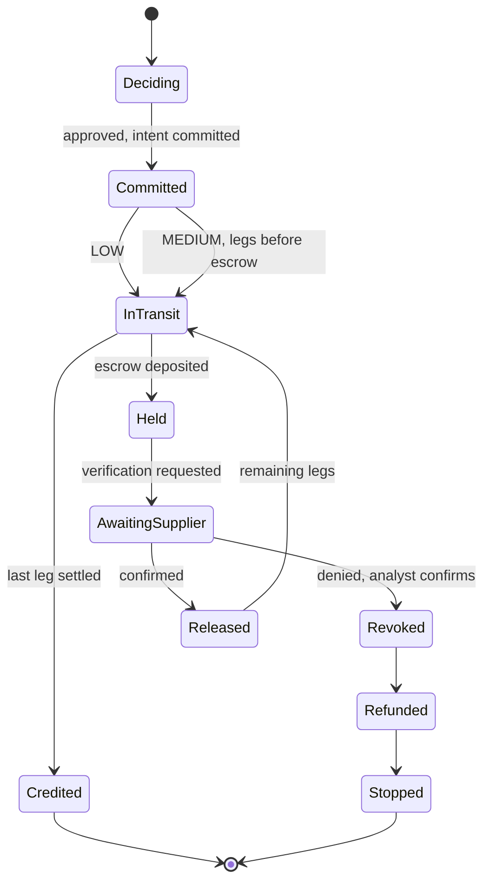

# Sylo.ai v0 — build specification (walking skeleton)

> **Audience:** the coding agent that builds v0 in one pass, and the four teammates who review it.
> **Read first:** [`project-context.md`](./project-context.md). Where this spec and the PRD disagree, **this spec wins for v0**.
> **Branch:** `v0/skeleton` from `main`, merged by pull request, then tagged `v0`.

---

## 0. Mission

Build a runnable monorepo in which the whole demo story (Scene 1 legit payment, Scene 2 diverted invoice, Scene 2b release attack) plays **on a 3D globe on one laptop**, driven by a Python engine with deterministic rules and a simulated chain, and with the shared interfaces (`/spec`) that let four people extend it in parallel from v1.

**v0 is done when every check in §12 passes.**

## 1. Scope

**In v0**

- `/spec`: event schema, API description, EIP-712 types and test vector, geography, canonical scenario data, port interfaces, conformance tests, recorded fixtures.
- `/engine`: FastAPI app with norms (YAML), rules-based risk, router (route score), EIP-712 intent building and signing with dev keys, `MockChain`, orchestrator state machine, server-sent-event stream, fixture recorder, tests.
- `/contracts`: `PaymentRegistry`, `PaymentEscrow`, `MockEURC`, Foundry tests (including the shared EIP-712 vector), deploy script (not run against Fuji in v0).
- `/ml` and `/chain`: package skeletons with stubs and READMEs (Lanes B and C build them in v1).
- `/web`: Next.js app with the globe, payment card, alert overlay, event feed, demo controls, mode banner, live and replay sources, reducer tests.
- Root: `Makefile`, `scripts/dev.sh`, `.env.example`, `.gitignore`, CI workflows, `CODEOWNERS` template, English `README.md`.

**Not in v0** (later versions; do not build): real Fuji transactions, trained model, LLM calls, payer approval UI, phone panels, analyst console, rail adapters, hash-chained log, circuit breaker, guardian, eERC, database, authentication, Docker.

## 2. Prerequisites on the build machine

| Tool | Version | Install |
|---|---|---|
| git | any | — |
| Node.js | ≥ 20 (24 is fine) | — |
| pnpm | ≥ 9 | `corepack enable` |
| uv | latest | `curl -LsSf https://astral.sh/uv/install.sh \| sh` |
| Python | 3.12 (via uv) | `uv python install 3.12` |
| Foundry | latest | `curl -L https://foundry.paradigm.xyz \| bash` then `foundryup` |

Package installs need network access. No API keys or wallets are needed for v0.

## 3. Repository layout (create exactly this)

```
AGENTS.md                          exists — do not rewrite
README.md                          rewrite in English (§9.6)
Makefile
.env.example
.gitignore
.python-version                    3.12
.github/
  CODEOWNERS                       commented template (§9.5)
  workflows/
    ci-spec.yml  ci-engine.yml  ci-ml.yml  ci-contracts.yml  ci-web.yml
docs/                              exists
scripts/
  dev.sh                           starts engine + web; Ctrl-C stops both
spec/
  README.md                        rules for changing the spec (copy §4.0)
  events.schema.json
  api.md
  eip712.json
  geo/institutions.json
  fixtures/
    scene1-legit.jsonl
    scene2-diverted.jsonl          ends at verification.requested
    scene2-deny.jsonl              continues scene2 after a "deny"
    scene2-confirm.jsonl           continues scene2 after a "confirm"
    scene2b-release-revoked.jsonl  continues scene2-deny
  scripts/validate.py              validates every fixture against the schema
  python/
    pyproject.toml                 package "sylo-spec"
    sylo_spec/__init__.py
    sylo_spec/models.py            Pydantic models
    sylo_spec/ports.py             RiskPort, ChainPort, ChainReverted
    sylo_spec/eip712.py            typed-data builders, struct hash, digest, signing
    sylo_spec/canonical.py         canonical JSON, keccak helpers
    sylo_spec/devkeys.py           public Anvil test keys (local and mock only)
    sylo_spec/scenarios.py         canonical parties, payees, accounts, orders
    sylo_spec/conformance/__init__.py
    sylo_spec/conformance/risk.py
    sylo_spec/conformance/chain.py
    tests/test_eip712_vector.py
    tests/test_fixtures_schema.py
engine/
  pyproject.toml                   package "sylo-engine"
  profiles/FR.yaml  profiles/GH.yaml
  packs/FR-GH.yaml
  sylo/__init__.py
  sylo/main.py                     FastAPI app and routes
  sylo/config.py                   env flags
  sylo/bus.py                      event bus, session buffer, SSE fan-out
  sylo/pacer.py                    RealPacer, VirtualPacer
  sylo/norms.py
  sylo/risk_rules.py               RulesRisk (implements RiskPort)
  sylo/router.py
  sylo/signer.py                   role keys and EIP-712 signing
  sylo/chain_mock.py               MockChain (implements ChainPort)
  sylo/ports_loader.py             picks implementations from flags, with fallback
  sylo/orchestrator.py             payment state machine and scenario scripts
  sylo/texts.py                    every user-facing sentence
  sylo/record_fixtures.py          python -m sylo.record_fixtures [--check]
  tests/
    test_norms.py  test_risk_rules.py  test_router.py  test_signer_vector.py
    test_mockchain_conformance.py  test_risk_conformance.py
    test_scenarios.py  test_api.py
ml/
  pyproject.toml                   package "sylo-risk" (skeleton)
  README.md
  sylo_risk/__init__.py            exports ModelRisk
  sylo_risk/model_risk.py          stub: raises NotImplementedError
  tests/test_conformance.py        skipped until ModelRisk is implemented
chain/
  pyproject.toml                   package "sylo-chain" (skeleton)
  README.md
  sylo_chain/__init__.py           exports FujiChain
  sylo_chain/fuji.py               stub: raises NotImplementedError
  tests/test_conformance.py        skipped until FujiChain is implemented
contracts/
  foundry.toml
  remappings.txt
  src/SyloTypes.sol                structs, enums, typehashes
  src/PaymentRegistry.sol
  src/PaymentEscrow.sol
  src/MockEURC.sol
  test/PaymentRegistry.t.sol
  test/PaymentEscrow.t.sol
  test/Eip712Vector.t.sol
  script/Deploy.s.sol
  deployments/.gitkeep
  lib/openzeppelin-contracts       git submodule (forge install)
web/
  created with create-next-app (TypeScript, App Router, Tailwind, ESLint)
  app/layout.tsx  app/page.tsx  app/globals.css
  components/GlobeStage.tsx        client component; dynamic-imports GlobeCanvas with ssr: false
  components/GlobeCanvas.tsx       the ONLY file that imports react-globe.gl
  components/PaymentCard.tsx
  components/AlertOverlay.tsx
  components/EventFeed.tsx
  components/DemoControls.tsx
  components/ModeBanner.tsx
  lib/events.ts                    TypeScript types mirroring events.schema.json
  lib/store.ts                     pure reducer: events -> view state
  lib/source.ts                    LiveSource (EventSource) and ReplaySource (fixtures)
  lib/geo.ts                       institutions, great-circle midpoint
  lib/colors.ts
  lib/__tests__/store.test.ts      vitest
  scripts/sync-spec.mjs            copies ../spec/geo and ../spec/fixtures to public/spec
```

## 4. Shared spec (`/spec`)

### 4.0 Rules for changing the spec (copy into `spec/README.md`)

1. Changes are **additive only**: new event types, new optional fields, new endpoints. Never rename or remove.
2. Every data object allows additional properties, so consumers ignore unknown fields.
3. A spec pull request touches only `/spec` and needs approval from **two lanes** (producer and at least one consumer).
4. Changing an event's content requires re-recording fixtures (`make fixtures`) in the same pull request.

### 4.1 Event envelope (`events.schema.json`, JSON Schema draft 2020-12)

```json
{
  "v": 1,
  "seq": 14,
  "id": "evt-000014",
  "ts": "2026-10-11T09:00:12.300Z",
  "type": "payment.held",
  "paymentId": "PAY-2026-0002",
  "simulated": true,
  "data": {}
}
```

- `seq` increases by one within a session; `id` is `evt-` + `seq` zero-padded to 6 digits. Exception: the `system.mode` message sent to each new stream connection has `seq: 0` and is not stored in the session.
- `paymentId` is null for session-level events.
- `simulated` is **true** when the event describes something that did not happen on a real external system: rail legs (always simulated), mock-chain transactions, the telecom mock. Decision events (`norms.checked`, `risk.scored`, `route.selected`) are **false**: they are real computations on synthetic data.
- The schema validates the envelope and, per `type`, the required `data` fields below (`if/then` on `type`). Every `data` object has `additionalProperties: true`.

### 4.2 Event catalogue (v0)

Field notation is TypeScript-like. `Hop = { from: InstitutionId, to: InstitutionId, kind: "bank" | "chain" | "wallet" }`. Amounts are decimal strings (`"85000.00"`).

| Type | Emitted when | `data` |
|---|---|---|
| `session.reset` | `POST /v1/reset` | `{}` |
| `system.mode` | engine start, each stream connect, any mode change | `{ risk: "rules"\|"model", chain: "mock"\|"fuji", llm: "off"\|"cached"\|"live", rails: "simulated", degraded: string[] }` |
| `scenario.started` | a scenario run starts | `{ scenario: "legit"\|"diverted", speed: number, auto: boolean }` |
| `payment.created` | order received | `{ uetr, payer: { id, name, institutionId }, beneficiary: { payeeName, accountHolder, accountMasked, institutionId, knownPayee: boolean, knownAccount: boolean }, amount: { value, currency }, purpose, invoiceRef, provenance, senderDomain? }` |
| `norms.checked` | norms evaluated | `{ packVersion, routes: [{ routeId, name, settlement, hops: Hop[], status: "PASS"\|"EXCLUDED", excludedBy?: string, reason?: string, legalRef?: string }], signals: [{ code, text, ruleId }], taxNotices: [{ text, reference }] }` |
| `risk.scored` | risk computed | `{ score: 0-100, tier: "LOW"\|"MEDIUM"\|"HIGH"\|"CRITICAL", rulesFired: string[], reasons: [{ ref, text }], model: string }` |
| `route.selected` | route chosen | `{ routeId, name, settlement, tier, scores: [{ routeId, s: number\|null, excludedBy: string\|null }], reason, feesEur, etaLabel, priceOfSafetyEur }` |
| `approval.granted` | approval recorded (auto in v0) | `{ by: [{ name, role }], method: "SCA"\|"DUAL_CONTROL", conditional: boolean, approvalHash }` |
| `intent.committed` | `commit` succeeded | `{ intentHash, tier, txHash, explorerUrl: string\|null }` |
| `leg.sent` | a hop starts | `{ hop: number, from, to, kind, rail, durationMs }` |
| `leg.settled` | a hop completes | `{ hop: number, at: InstitutionId }` |
| `escrow.deposited` | `deposit` succeeded | `{ amount, token: "tEURC", expiresAt, txHash, explorerUrl }` |
| `payment.held` | money stopped | `{ hop, at: "escrow"\|"bank", tier, headline, reasons: [{ ref, text }], protection, nextStep, expiresAt }` |
| `verification.requested` | out-of-band request sent | `{ contactName, contactMasked, contactSince, channel: "SMS", simSwapChecked: true, simSwapRecent: boolean }` |
| `verification.recorded` | `recordVerification` succeeded | `{ result: "CONFIRMED"\|"DENIED", answerText, txHash, explorerUrl }` |
| `intent.revoked` | `revoke` succeeded | `{ reasonCode: "SUPPLIER_DENIED", by, txHash, explorerUrl }` |
| `escrow.refunded` | `refund` succeeded | `{ to: InstitutionId, amount, txHash, explorerUrl }` |
| `escrow.released` | `release` succeeded | `{ to: InstitutionId, amount, txHash, explorerUrl }` |
| `intent.executed` | registry status becomes EXECUTED | `{ txHash, explorerUrl }` |
| `payment.credited` | last hop settled | `{ at: InstitutionId, feesEur, routeCostEur, swiftRouteCostEur, elapsedLabel }` |
| `payment.stopped` | refund finished | `{ headline, detail }` |
| `attack.attempted` | attack endpoint called | `{ attack: "release_revoked", description, by: "attacker" }` |
| `tx.reverted` | a chain call reverted | `{ function, reason, txHash: string\|null, explorerUrl: string\|null }` |

**Reserved for later versions** (declare the names in the schema with a free-form `data`, never emit in v0): `approval.required`, `leg.rejected`, `case.ready`, `case.action`, `alert.raised`, `cluster.detected`, `breaker.on`, `breaker.off`, `rail.down`, `rail.up`, `killswitch.on`, `guardian.incident`, `confidential.transfer`, `root.anchored`, `traffic.sample`.

### 4.3 API (`spec/api.md`)

Base URL `http://localhost:8000`. JSON everywhere. CORS allows `http://localhost:3000`.

| Method | Path | Body | Response | Errors |
|---|---|---|---|---|
| GET | `/health` | — | `{ ok: true, mode: {...system.mode data} }` | — |
| GET | `/v1/stream` | — | Server-sent events. Each message: `id: <seq>`, `data: <event JSON>`. On connect: one `system.mode` (`seq: 0`), then every event of the current session in order, or only events after `Last-Event-ID` when the browser reconnects with that header | — |
| POST | `/v1/scenarios/{name}/run` | `{ speed?: number = 1, auto?: boolean = false }` | `{ paymentId }` | 404 unknown name; 409 a scenario is running |
| POST | `/v1/payments/{paymentId}/supplier-response` | `{ answer: "confirm" \| "deny" }` | `{ ok: true }` | 404; 409 not waiting for an answer |
| POST | `/v1/attacks/{name}` | `{ paymentId }` | `{ ok: true, reverted: boolean, reason: string \| null }` | 404 unknown attack or payment; 409 payment not in a state where the attack makes sense |
| POST | `/v1/reset` | — | `{ ok: true }` (cancels the running scenario, emits `session.reset`) | — |
| GET | `/v1/payments/{paymentId}` | — | `{ paymentId, status, tier, routeId, chainStatus, lastSeq }` | 404 |

`name` for scenarios: `legit`, `diverted`. `name` for attacks in v0: `release_revoked`. With `auto: true`, the diverted scenario answers the supplier request itself after 3,000 ms (scaled by speed) with `deny` (or `confirm` if `{ auto: true, autoAnswer: "confirm" }`).

### 4.4 EIP-712 (`spec/eip712.json`) — must match PRD §13.4 exactly

**Domain:** `{ name: "SyloPaymentRegistry", version: "1", chainId, verifyingContract }`.

**Types (field order is binding):**

```
PaymentIntent(bytes32 paymentId,bytes32 corridorId,address beneficiary,address token,uint256 amount,bytes32 offchainHash,bytes32 decisionHash,bytes32 approvalHash,uint8 tier,uint64 validUntil,uint256 nonce)
VerificationAttestation(bytes32 paymentId,bytes32 intentHash,uint8 method,uint8 result,bool simSwapChecked,bytes32 evidenceHash,uint64 verifiedAt,uint256 nonce)
Revocation(bytes32 paymentId,uint8 reasonCode,bytes32 caseHash,uint256 nonce)
```

**Enumerations (same numbers in Python, Solidity and TypeScript):**

| Enum | Values |
|---|---|
| Tier | LOW = 0, MEDIUM = 1, HIGH = 2, CRITICAL = 3 |
| Status | NONE = 0, COMMITTED = 1, CONFIRMED = 2, DENIED = 3, REVOKED = 4, EXECUTED = 5 |
| Verification method | OOB_KNOWN_CONTACT = 1, PSP_ATTESTATION = 2 |
| Verification result | CONFIRMED = 1, DENIED = 2 |
| Revocation reason | SUPPLIER_DENIED = 1, ANALYST_DECISION = 2, KILL_SWITCH = 3, EXPIRED = 4 |

**Hashing conventions:**

- `canonical_json(x)` = `json.dumps(x, sort_keys=True, separators=(",", ":"), ensure_ascii=False).encode("utf-8")`.
- `paymentId` (bytes32) = `keccak256(utf8("PAY-2026-0001"))`; `corridorId` = `keccak256(utf8("FR-GH"))`.
- `offchainHash` = `keccak256(salt32 ‖ canonical_json(offchain fields: creditor name, account, bank, invoiceRef, uetr))`, with a random 32-byte salt per payment (seeded in tests and fixtures).
- `decisionHash`, `approvalHash`, `evidenceHash`, `caseHash` = `keccak256(canonical_json(record))`.
- **`intentHash` = the EIP-712 digest** `keccak256(0x1901 ‖ domainSeparator ‖ structHash)`. The registry stores it; `VerificationAttestation.intentHash` must equal it.

**File content:** the domain used for the vector is `{ chainId: 43113, verifyingContract: "0x0000000000000000000000000000000000000001" }`; one example message per type (uint values as decimal strings); and for each, the expected `structHash` and `digest`. **Compute these values by running `sylo_spec.eip712`; never type them by hand.** Python and Solidity tests both assert against this file.

### 4.5 Geography (`spec/geo/institutions.json`)

All names are fictional.

| id | name | kind | city | country | lat | lng |
|---|---|---|---|---|---|---|
| `payer_rhone` | Rhône Cosmétiques SAS | business | Lyon | FR | 45.7640 | 4.8357 |
| `bank_fr` | Banque Hexagone | bank | Paris | FR | 48.8566 | 2.3522 |
| `casp_eu` | EuroLedger CASP | casp | Frankfurt | DE | 50.1109 | 8.6821 |
| `corr_uk` | Thames Correspondent Bank | correspondent | London | GB | 51.5072 | -0.1276 |
| `payout_nl` | Meridian Payouts | payout_provider | Amsterdam | NL | 52.3676 | 4.9041 |
| `remit_fr` | QuickRemit | remittance | Marseille | FR | 43.2965 | 5.3698 |
| `vasp_gh` | Kente Digital Assets (licensed VASP) | vasp | Accra | GH | 5.6037 | -0.1870 |
| `bank_gh` | Gold Coast Commercial Bank (nominated bank) | bank | Kumasi | GH | 6.6885 | -1.6244 |
| `momo_gh` | AccraPay Wallets | wallet_operator | Takoradi | GH | 4.8845 | -1.7554 |
| `supplier_ssx` | Savanna Shea Exports Ltd | business | Tamale | GH | 9.4034 | -0.8424 |
| `mule_bank` | Volta Rural Bank, Aflao branch | bank | Aflao | GH | 6.1186 | 1.1903 |

Also in the file: `"chain": { "name": "Avalanche C-Chain (Fuji)", "arcAltitude": 0.45 }`.

### 4.6 Canonical scenario data (`sylo_spec/scenarios.py`)

Shared by the engine (to run the scenarios) and by Lane B (golden test cases). Pydantic objects, not dicts.

**Parties**

- Payer: `payer_rhone`, Rhône Cosmétiques SAS; approvers Claire Martin (CFO) and Marc Durand (second approver). Payer bank `bank_fr`.
- Supplier payee `payee-ssx`: Savanna Shea Exports Ltd, country GH.
  - Account `acc-ssx-nominated` at `bank_gh`: nominated for exports, first seen 2024-03-12, 14 successful payments, verified by `OOB_KNOWN_CONTACT`.
  - Known contact: Kwame Asante, `+233 •• ••• 4471`, registered 2024-03-12.
- Mule account `acc-mensah-aflao` at `mule_bank`: holder "K. MENSAH VENTURES", opened 9 days before the demo date, 0 payments, not nominated.

**Orders**

| Field | `legit` (PAY-2026-0001) | `diverted` (PAY-2026-0002) |
|---|---|---|
| Amount | EUR 85,000.00 | EUR 85,000.00 |
| Purpose | GOODS | GOODS |
| Invoice | SSE-2026-118 | SSE-2026-118 |
| LOC reference | LOC-GH-2026-0457 | LOC-GH-2026-0457 |
| Creditor account | `acc-ssx-nominated` | `acc-mensah-aflao` |
| Provenance of account details | `verified_registry` | `invoice_pdf_email` |
| Sender domain | — | `savannashea-exports.com` (known domain: `savanna-shea.com`) |
| Payer session | normal (no SIM swap, known device, FR) | normal |

UETRs are fixed UUIDs in the file (deterministic).

### 4.7 Ports and conformance (`sylo_spec/ports.py`, `sylo_spec/conformance/`)

```python
class RiskPort(Protocol):
    name: str                                   # "rules-v0", "model-v1", ...
    def score(self, order: PaymentOrder, ctx: RiskContext) -> RiskResult: ...

class ChainReverted(Exception):
    reason: str                                 # Solidity custom error name, e.g. "PaymentNotReleasable"
    tx: TxRef | None                            # set when a failed transaction was mined

class ChainPort(Protocol):
    mode: str                                   # "mock", "anvil", "fuji"
    def domain(self) -> Eip712Domain: ...
    def commit(self, intent: PaymentIntent, router_sig: bytes) -> TxRef: ...
    def deposit(self, intent: PaymentIntent, payer: str) -> TxRef: ...
    def record_verification(self, att: VerificationAttestation, verifier_sig: bytes) -> TxRef: ...
    def revoke(self, rev: Revocation, analyst_sig: bytes) -> TxRef: ...
    def release(self, payment_id: bytes, caller: str = "relayer") -> TxRef: ...
    def refund(self, payment_id: bytes) -> TxRef: ...
    def mark_executed(self, payment_id: bytes, execution_ref: bytes) -> TxRef: ...
    def status(self, payment_id: bytes) -> Status: ...
    def intent_hash(self, payment_id: bytes) -> bytes: ...
```

- `TxRef = { txHash: str, explorerUrl: str | None, simulated: bool, blockNumber: int | None }`.
- `Eip712Domain = { name, version, chainId, verifyingContract }`.
- Models use Pydantic v2 with camelCase JSON aliases (`alias_generator=to_camel`, `populate_by_name=True`).
- `RiskContext = { payee, account, normSignals: list[str], payerSession: { simSwap72h, newDevice24h, country }, nameMatch: float, accountAgeHours: float, amountEur: float }`.
- `RiskResult = { score: int, tier: Tier, floorTier: Tier, rulesFired: list[str], reasons: list[{ref, text}], model: str }`.

**Risk conformance** (`run_risk_conformance(risk)`): legit golden case gives LOW; diverted golden case gives at least MEDIUM with at least 3 reasons; same input gives same output; p95 latency < 50 ms over 200 calls; output validates.

**Chain conformance** (`run_chain_conformance(make_chain)`), each step on a fresh chain:

1. Commit signed by the router key → status COMMITTED. Committing the same payment again → `InvalidTransition`.
2. Commit signed by a non-router key → `UnauthorizedSigner`.
3. Reusing a nonce for the same signer → `NonceUsed`.
4. Deposit with an amount different from the intent → `CommitmentMismatch`. Deposit of a committed LOW intent → `TierNotEscrowable`.
5. MEDIUM intent committed and deposited; DENIED attestation → DENIED; revoke → REVOKED; `release` → `PaymentNotReleasable`; `refund` → succeeds; second `refund` → `AlreadySettled`.
6. MEDIUM intent committed and deposited; CONFIRMED attestation → `release` succeeds → status EXECUTED.
7. LOW intent: commit → `mark_executed` → EXECUTED.

Keys for the tests come from `sylo_spec.devkeys`: the public Anvil accounts of mnemonic `test test test test test test test test test test test junk` (index 0 deployer, 1 relayer, 2 router signer, 3 verifier signer, 4 analyst signer, 5 guardian, 6 EU CASP payer treasury, 7 GH VASP beneficiary, 8 attacker). **These keys are public: use them only in mock and local mode, never fund them on Fuji.**

### 4.8 Fixtures (`spec/fixtures/*.jsonl`)

- One event per line, recorded by `make fixtures` (engine, `VirtualPacer`, start time `2026-10-11T09:00:00.000Z`, seed 42, speed 1, `auto: true`).
- `scene1-legit` and `scene2-diverted` each start at `seq` 1. Branch files continue the numbering of the file they follow.
- Recording twice gives byte-identical files (`make fixtures-check` fails otherwise).

## 5. Engine (`/engine`)

### 5.1 Packaging and configuration

- `pyproject.toml`: Python ≥ 3.11; deps `fastapi`, `uvicorn[standard]`, `sse-starlette`, `pydantic>=2`, `pyyaml`, `eth-account`, `sylo-spec`; dev deps `pytest`, `pytest-asyncio`, `httpx`, `jsonschema`. Optional extras `model = ["sylo-risk"]`, `fuji = ["sylo-chain"]`. `[tool.uv.sources]` maps the three local packages to `../spec/python`, `../ml`, `../chain` (editable).
- Flags (`config.py`, read from env with these defaults): `RISK_MODE=rules`, `CHAIN_MODE=mock`, `LLM_MODE=off`, `DEMO_SPEED=1`, `ENGINE_PORT=8000`, `CORS_ORIGINS=http://localhost:3000`, `SEED=42`, `ESCROW_HOLD_SECONDS=86400`.

### 5.2 Port loader (`ports_loader.py`)

- `RISK_MODE=model`: import `sylo_risk.ModelRisk`; on any exception, use `RulesRisk` and add `"risk"` to `system.mode.degraded`.
- `CHAIN_MODE=fuji`: import `sylo_chain.FujiChain`; on any exception, use `MockChain` and add `"chain"` to `degraded`.
- Chain calls are synchronous; the orchestrator calls them through `asyncio.to_thread`.
- With the model available, the engine combines both: `floorTier` and `rulesFired` from `RulesRisk`, `score` and extra reasons from the model, final `tier = max(floorTier, band(score))`. In v0 only `RulesRisk` exists.

### 5.3 Event bus and stream (`bus.py`)

- In-memory session: list of events, `seq` counter, subscriber queues.
- `publish(type, paymentId, data, simulated)` stamps `seq`, `id`, `ts` (from the pacer clock) and fans out.
- `/v1/stream` uses `sse-starlette`. On connect, send `system.mode`, then the session buffer, then live events. Send a heartbeat comment every 15 s.

### 5.4 Pacer (`pacer.py`)

- `RealPacer(speed)`: `await asyncio.sleep(ms / speed / 1000)`; clock = wall time.
- `VirtualPacer(start)`: no sleeping; advances a virtual clock by `ms / speed`. Used by tests and the fixture recorder.
- All waits in the orchestrator go through the pacer, so tests run in milliseconds.

### 5.5 Norms (`norms.py`, `profiles/*.yaml`, `packs/FR-GH.yaml`)

**Pack `FR-GH`** (version `2026-10-10`) defines the four routes. Hops per route (the last hops depend on the creditor's institution, `{CRED}` = `bank_gh` for legit or `mule_bank` for diverted; for legit the route then continues `bank_gh → supplier_ssx`):

| Route | Name | Settlement | Hops |
|---|---|---|---|
| R1 | SWIFT correspondent | FIAT_HOLD | `payer_rhone→bank_fr` (bank), `bank_fr→corr_uk` (bank), `corr_uk→{CRED}` (bank) |
| R2 | Payout provider | NONE | `payer_rhone→bank_fr` (bank), `bank_fr→payout_nl` (bank), `payout_nl→{CRED}` (bank) |
| R3 | Euro stablecoin on Avalanche | ONCHAIN_ESCROW | `payer_rhone→bank_fr` (bank), `bank_fr→casp_eu` (bank), `casp_eu→vasp_gh` (**chain**), `vasp_gh→{CRED}` (bank) |
| R4 | Mobile wallet remittance | NONE | `payer_rhone→remit_fr` (wallet), `remit_fr→momo_gh` (wallet) — the money would end in a wallet |

Legit R3 therefore has 5 hops: `payer_rhone→bank_fr→casp_eu→vasp_gh→bank_gh→supplier_ssx`. Diverted R3 has 4 hops ending at `mule_bank`.

**Rule results.** Each rule returns `PASS`, `FAIL` or `NEEDS_DOCUMENT`; any `FAIL` or `NEEDS_DOCUMENT` excludes the route (unknown = fail).

| Rule | Applies to | Check | v0 result |
|---|---|---|---|
| `GH_FX_EXPORT_PROCEEDS_NOMINATED_BANK` (route part) | purpose GOODS, creditor in GH | the route credits a bank account, not a wallet, and the order has a LOC reference | R4 FAIL (excluded); others PASS |
| `GH_FX_EXPORT_PROCEEDS_NOMINATED_BANK` (payment part) | same | the creditor account is the exporter's nominated account | legit: no signal. diverted: **signal R1** (does not exclude routes) |
| `GH_WALLET_DAILY_CAP` | R4 | amount in GHS (fixed rate 1 EUR = 16.5 GHS, labelled) ≤ 25,000 per day | R4 FAIL |
| `GH_VASP_LICENSED` | R3 | `vasp_gh` is in the licensed list | PASS |
| `EU_MICA_EMT_CASP` | R3 | `casp_eu` authorised and token is an authorised e-money token | PASS |
| `EU_TRAVEL_RULE` | R3 | originator and beneficiary fields present | PASS |
| `SANCTIONS_SCREEN` | all | names not on the synthetic list | PASS |

`legalRef` strings come from PRD §9.3. The excluded R4 shows the first failing rule (`GH_FX_EXPORT_PROCEEDS_NOMINATED_BANK`) with reason text from `texts.py`.

**Tax notices** (information only, never change anything): "No Ghanaian withholding tax on payments for goods by a non-resident buyer; France–Ghana tax convention (1993) in force." (`FR-GH-DTC-1993`) and, when R3 is a candidate, "The EU crypto-asset provider reports this leg under DAC8 (since 1 January 2026)." (`DAC8`).

### 5.6 Rules-based risk (`risk_rules.py`, class `RulesRisk`)

| Rule | Condition | Floor tier | Weight | Reason (ref) |
|---|---|---|---|---|
| R-HB-01 | sanctions hit | CRITICAL | score = 95 | — |
| R-PV-01 | account details from untrusted provenance (not `verified_registry`, `payment_history`, `psp_attestation`) | MEDIUM | +20 | V |
| R-FL-01 | new account (0 payments) ∧ untrusted provenance ∧ amount ≥ EUR 10,000 | MEDIUM | +15 | B |
| R-FL-02 | account age < 72 h ∧ amount ≥ EUR 5,000 | MEDIUM | +10 | B |
| R-FL-03 | name match < 0.85 | MEDIUM | +12 | B |
| R-NM-01 | norm signal R1 | MEDIUM | +7 | R |

- `score = min(100, 10 + sum of weights)`; bands 0–39 LOW, 40–69 MEDIUM, 70–89 HIGH, 90–100 CRITICAL; `tier = max(floorTier, band(score))`.
- Name match: uppercase, strip punctuation and the legal suffixes LTD, LIMITED, SAS, SA, SARL (keep every other word), then `difflib.SequenceMatcher` ratio; shown with two decimals.
- When no rule fires and the account is known, `RulesRisk` still returns the two positive reasons below, so the card always explains the decision.
- Expected: **legit → score 10, LOW**, reasons "Known supplier: 14 successful payments to this nominated account since 2024." (B) and "Bank details come from the verified supplier registry." (V). **Diverted → score 64, MEDIUM**, rules `R-PV-01, R-FL-01, R-FL-03, R-NM-01`, four reasons (texts in §5.11), sorted by weight.

### 5.7 Router (`router.py`)

Rail parameters (in the pack YAML):

| Route | Fees | Time `T` (days) | pFail | pUnusable |
|---|---|---|---|---|
| R1 | €80 | 2 | 0.01 | 0 |
| R2 | €935 | 1/24 | 0.0025 | 0 |
| R3 | €170 | 2/24 | 0.0025 | 0 |
| R4 | 1.5% of amount | 10/1440 | 0.03 | 0.05 |

- `S(r) = fees + λ·A·T + μ·A·pFail + ν·A·pUnusable + σ·routeRisk`, with λ = 0.0007, μ = 0.02, ν = 0.05, σ = 1, routeRisk = 0 in v0. **Fraud risk is never an input.**
- Eligible: norms PASS ∧ tier LOW, or tier MEDIUM ∧ settlement in {ONCHAIN_ESCROW, FIAT_HOLD}; HIGH and CRITICAL → no route.
- Expected for A = 85,000: **R1 = 216.00, R3 = 179.21, R2 = 941.73**, R4 excluded → R3. At MEDIUM, R2 is excluded with `excludedBy: "TIER_MEDIUM_REQUIRES_CONDITIONAL_SETTLEMENT"`.
- `priceOfSafetyEur` = S(best at this tier) − S(best if LOW) → 0 in both scenarios.
- `etaLabel`: R3 "≈ 2 h", R1 "1–3 days".

### 5.8 Signer and intents (`signer.py`)

- Role keys from env `ROUTER_SIGNER_PK`, `VERIFIER_SIGNER_PK`, `ANALYST_SIGNER_PK`; in mock mode, if unset, use `sylo_spec.devkeys`.
- Build `PaymentIntent` with: beneficiary = GH VASP address, token = `TOKEN_ADDRESS` (mock default `0x0000000000000000000000000000000000000E0C`), amount = 85,000 × 10⁶ (6 decimals), `validUntil` = now + 600 s, nonce = per-signer counter.
- Domain from `chain.domain()`; MockChain returns `{ chainId: 43113, verifyingContract: REGISTRY_ADDRESS or 0x…0001 }`.

### 5.9 MockChain (`chain_mock.py`)

- Mirrors the contract rules exactly (same statuses, same error names, signature recovery with `eth-account`, role checks against the dev or env addresses, nonce tracking, escrow holds with expiry, `AlreadySettled`).
- Transaction hashes: `"0x" + keccak256(utf8(f"sylo-mock-{counter}")).hex()`; `explorerUrl = None`; `simulated = True`.
- Passes `run_chain_conformance` (test in `engine/tests`).

### 5.10 Orchestrator (`orchestrator.py`)



**Timeline, `legit`** (delay = wait before the event, in ms at speed 1; all waits are divided by `speed`):

| # | Event | Delay | Notes |
|---|---|---|---|
| 1 | `scenario.started` | 0 | |
| 2 | `payment.created` | 400 | |
| 3 | `norms.checked` | 900 | R4 excluded |
| 4 | `risk.scored` | 900 | 10, LOW |
| 5 | `route.selected` | 900 | R3 |
| 6 | `approval.granted` | 1000 | Claire (SCA) and Marc (dual control, ≥ €20k); `conditional: false` |
| 7 | `intent.committed` | 900 | |
| 8–17 | `leg.sent` / `leg.settled` for hops 0–4 | `leg.sent` 300 after the previous event; `leg.settled` `durationMs` later | bank hops 1,400 ms; chain hop 2,200 ms |
| 18 | `intent.executed` | 400 | `mark_executed` |
| 19 | `payment.credited` | 300 | fees €170, route cost €179.21, SWIFT route €216.00, "≈ 2 h (simulated)" |

**Timeline, `diverted`:**

| # | Event | Delay | Notes |
|---|---|---|---|
| 1 | `scenario.started` | 0 | |
| 2 | `payment.created` | 400 | beneficiary "K. MENSAH VENTURES", `mule_bank`, provenance `invoice_pdf_email` |
| 3 | `norms.checked` | 900 | R4 excluded; signal R1 |
| 4 | `risk.scored` | 900 | 64, MEDIUM |
| 5 | `route.selected` | 900 | R3 with escrow; R2 excluded by tier |
| 6 | `approval.granted` | 1000 | `conditional: true` |
| 7 | `intent.committed` | 900 | tier MEDIUM |
| 8–11 | hops 0 and 1 (`leg.sent` / `leg.settled`) | as above | |
| 12 | `leg.sent` hop 2 (chain) | 300 | `durationMs` 2,200 |
| 13 | `escrow.deposited` | 1100 | the comet is halfway up the chain arc |
| 14 | `payment.held` | 200 | `hop: 2`, `at: "escrow"` |
| 15 | `verification.requested` | 1500 | SIM-swap check done, no recent swap |
| — | waits for `supplier-response` (or 3,000 ms with `auto`) | | |

Deny branch: `verification.recorded` DENIED (800) → `intent.revoked` (1500, by "Analyst (auto-confirmed in v0)") → `escrow.refunded` (1000) → `payment.stopped` (3200, after the refund animation).

Confirm branch: `verification.recorded` CONFIRMED (800) → `escrow.released` (1000) → `intent.executed` (300) → `leg.settled` hop 2 (1100) → `leg.sent` hop 3 (300, 1,400 ms) → `leg.settled` hop 3 (1400) → `payment.credited` (300).

**Attack `release_revoked`** (only when the payment is REVOKED, otherwise 409): `attack.attempted` (0) → call `chain.release(paymentId, caller="attacker")` → catch `ChainReverted` → `tx.reverted` (900) with `function: "release"`, `reason: "PaymentNotReleasable"`.

### 5.11 Texts (`texts.py`) — exact strings

| Key | Text |
|---|---|
| R4 excluded | "Excluded: Ghana requires export proceeds to reach the exporter's nominated bank account, and mobile wallets cannot receive them." |
| Signal R1 | "The requested account is not Savanna Shea's nominated export account." |
| R-PV-01 | "The new bank details came from an emailed invoice, not from Savanna Shea's verified records." |
| R-FL-01 | "This is the first payment ever to this account, and it is for EUR 85,000." |
| R-FL-03 | "The account holder 'K. MENSAH VENTURES' does not match the supplier 'Savanna Shea Exports Ltd' (name match {score})." |
| R-NM-01 | "Ghanaian rules require export payments to reach the exporter's nominated bank. This account is not it." |
| Route reason, LOW | "R3 is the cheapest compliant route: €179 all-in against €216 via SWIFT. R4 is excluded by Ghana's export-proceeds rule." |
| Route reason, MEDIUM | "Risk is MEDIUM, so only routes that can hold the money are allowed (R1 bank hold, R3 escrow). R3 is the cheapest: €179 against €216. Price of safety: €0." |
| Held headline | "Payment held: possible supplier impersonation" |
| Protection | "EUR 85,000 is locked in the escrow smart contract on Avalanche. It can only go to the account fixed in the signed payment or back to Rhône Cosmétiques. Automatic refund in 24 h if nobody confirms." |
| Next step | "We are asking Savanna Shea on the number already on file for Kwame Asante, after checking that it was not SIM-swapped." |
| Answer, deny | "Kwame Asante: \"We have not changed our bank details. Do not pay this account.\"" |
| Answer, confirm | "Kwame Asante: \"Yes, this is our new account.\"" |
| Stopped headline | "Payment stopped. EUR 85,000 returned to Rhône Cosmétiques." |
| Stopped detail | "The supplier denied the new bank details. The payment was revoked on-chain and refunded from escrow. A case was opened for the analyst." |
| Attack description | "An attacker calls release() on the revoked payment to push the money to the mule account." |
| Reverted | "Rejected by the smart contract: PaymentNotReleasable." |

### 5.12 Engine tests

- Norms: R4 excluded for both orders; signal R1 only for diverted; tax notices present.
- Risk: legit LOW 10; diverted MEDIUM 64 with the four rules; `run_risk_conformance(RulesRisk())` passes.
- Router: the three S values to 2 decimals; R2 excluded at MEDIUM.
- Signer: the EIP-712 vector digests match `spec/eip712.json`.
- MockChain: `run_chain_conformance(MockChain)` passes.
- Scenarios (VirtualPacer): exact event type sequences of §5.10 for legit, diverted+deny, diverted+confirm, attack; every event validates against `events.schema.json`.
- API: start uvicorn in a background thread on a free port, run legit at speed 50, read the stream with a real HTTP client until `payment.credited`; 409 when running two scenarios; reset works. Do not test the stream through httpx's ASGI transport: it buffers streaming responses and the test hangs.
- Fixtures: `python -m sylo.record_fixtures --check` passes.

## 6. Contracts (`/contracts`)

**Config.** `foundry.toml`: `solc_version = "0.8.28"`, `evm_version = "cancun"` (Fuji supports Cancun since the Etna upgrade, November 2024), optimizer on (200 runs), `fs_permissions = [{ access = "read", path = "../spec" }, { access = "read-write", path = "./deployments" }]`, `[rpc_endpoints] fuji = "${FUJI_RPC_URL}"`, `[etherscan] fuji = { key = "verifyContract", url = "https://api.routescan.io/v2/network/testnet/evm/43113/etherscan", chain = 43113 }`. OpenZeppelin Contracts v5.x installed with `forge install`; remapping `@openzeppelin/contracts/=lib/openzeppelin-contracts/contracts/`.

**`SyloTypes.sol`**: the three structs, the enums of §4.4, and the three typehash constants.

**`PaymentRegistry`** (`EIP712("SyloPaymentRegistry", "1")`, `AccessControl`):

- Roles: `ROUTER_SIGNER_ROLE`, `VERIFIER_SIGNER_ROLE`, `ANALYST_SIGNER_ROLE`, `EXECUTOR_ROLE`; admin = constructor argument.
- Storage per `paymentId`: intent digest, status, beneficiary, token, amount, tier, corridorId. Nonce usage per signer.
- `commit(PaymentIntent i, bytes sig)`: status must be NONE (`InvalidTransition`); `block.timestamp <= i.validUntil` (`IntentExpired`); signer recovered with `ECDSA.recover` (or `SignatureChecker` for contract signers) must hold `ROUTER_SIGNER_ROLE` (`UnauthorizedSigner`); nonce unused (`NonceUsed`); store; emit `PaymentCommitted`.
- `recordVerification(VerificationAttestation v, bytes sig)`: status COMMITTED; `v.intentHash` equals the stored digest (`CommitmentMismatch`); signer holds `VERIFIER_SIGNER_ROLE`; nonce unused; status CONFIRMED or DENIED; emit `VerificationRecorded`.
- `revoke(Revocation r, bytes sig)`: status in {COMMITTED, CONFIRMED, DENIED}; signer holds `ANALYST_SIGNER_ROLE`; nonce unused; status REVOKED; emit `PaymentRevoked`.
- `markExecuted(bytes32 paymentId, bytes32 executionRef)` (`EXECUTOR_ROLE`): COMMITTED with tier LOW, or CONFIRMED → EXECUTED; emit `PaymentExecuted`.
- Views: `statusOf`, `intentOf`, `paymentOf`, `digestOf(PaymentIntent)`, and public pure `hashIntent`, `hashVerification`, `hashRevocation` (struct hashes), `domainSeparator()`.
- Events and errors exactly as PRD §13.3 plus the error names of §4.7.

**`PaymentEscrow`** (`AccessControl`, `ReentrancyGuard`, `SafeERC20`):

- Roles: `ROUTER_ROLE` (relayer allowed to deposit), `ANALYST_ROLE`, `GUARDIAN_ROLE`. Constructor: registry, admin, `holdSeconds` (default 86,400; admin-settable).
- `deposit(PaymentIntent i, address payer)` (`ROUTER_ROLE`): registry status COMMITTED; `registry.digestOf(i) == registry.intentOf(i.paymentId)` (`CommitmentMismatch`); tier MEDIUM (`TierNotEscrowable`); no existing hold (`AlreadyDeposited`); pull `amount` of `token` from `payer` (payer approved the escrow); `expiresAt = now + holdSeconds`; emit `Deposited`.
- `release(bytes32 paymentId)` (anyone): hold exists, not settled, not frozen, not expired, corridor not paused, registry status CONFIRMED — otherwise revert `PaymentNotReleasable`. Mark settled, transfer to the intent's beneficiary, call `registry.markExecuted` (escrow holds `EXECUTOR_ROLE`), emit `Released`.
- `refund(bytes32 paymentId)`: allowed for `ANALYST_ROLE` at any time, and for anyone when the registry status is REVOKED or the hold expired; not already settled (`AlreadySettled`); transfer back to the payer; emit `Refunded(paymentId, expired)`.
- `freeze(bytes32 paymentId)` (`ANALYST_ROLE` or `GUARDIAN_ROLE`), `pauseCorridor(bytes32)` (`GUARDIAN_ROLE`), `unpauseCorridor(bytes32)` (admin).
- No function lets anyone withdraw funds other than release to the beneficiary or refund to the payer.

**`MockEURC`**: ERC-20 "Sylo Test Euro" / `tEURC`, 6 decimals, `mint` restricted to the owner.

**Tests (Foundry):**

- `Eip712Vector.t.sol`: read `../spec/eip712.json` with `vm.readFile`, extract fields with `vm.parseJsonBytes32 / parseJsonUint / parseJsonAddress`, assert `hashIntent/hashVerification/hashRevocation` equal the vector's `structHash`, and that `keccak256(abi.encodePacked("\x19\x01", domainSeparatorFor(vectorDomain), structHash))` equals `digest`.
- Registry: every allowed transition; every forbidden transition reverts with the right error; wrong signer; nonce reuse; expiry.
- Escrow: deposit mismatch (amount and beneficiary) reverts; LOW deposit reverts; release reverts unless CONFIRMED, and when frozen, expired or paused; refund permissionless after revoke and after expiry (`vm.warp`); double refund reverts; balance equals the sum of open holds.

**`script/Deploy.s.sol`** (not run against Fuji in v0): reads `DEPLOYER_PK`, `RELAYER_ADDRESS`, `ROUTER_SIGNER_ADDRESS`, `VERIFIER_SIGNER_ADDRESS`, `ANALYST_SIGNER_ADDRESS`, `GUARDIAN_ADDRESS`, `EU_CASP_ADDRESS`; deploys MockEURC, registry and escrow; grants roles:

- Registry: `ROUTER_SIGNER_ROLE`, `VERIFIER_SIGNER_ROLE`, `ANALYST_SIGNER_ROLE` to the three signer addresses; `EXECUTOR_ROLE` to the escrow contract and to the relayer.
- Escrow: `ROUTER_ROLE` to the relayer; `ANALYST_ROLE` to the analyst signer; `GUARDIAN_ROLE` to the guardian.

It then mints 10,000,000 tEURC to `EU_CASP_ADDRESS` and writes `deployments/<chainId>.json` with addresses and block numbers. The EU CASP's `approve` of the escrow is a separate script run with the EU CASP key (Lane C, v1). The deploy must run against a local Anvil node (`make anvil-deploy`).

## 7. `/ml` and `/chain` skeletons

- `ml/pyproject.toml`: package `sylo-risk`, deps `numpy`, `pandas`, `scikit-learn`, `sylo-spec` (path `../spec/python`). `ModelRisk.__init__` raises `NotImplementedError("Lane B implements ModelRisk in v1 (docs/roadmap-and-lanes.md, B1.4)")`. `tests/test_conformance.py` is skipped while the stub raises.
- `chain/pyproject.toml`: package `sylo-chain`, deps `web3>=7`, `sylo-spec`. `FujiChain.__init__` raises `NotImplementedError("Lane C implements FujiChain in v1 (docs/roadmap-and-lanes.md, C1.3)")`. Test skipped likewise.
- Each README lists the owner lane, the interface to implement, how to run the conformance test, and links to the roadmap tasks.

## 8. Web (`/web`)

### 8.1 Setup

- `pnpm create next-app@latest web --ts --tailwind --eslint --app --no-src-dir --import-alias "@/*" --use-pnpm` (non-interactive; accept the default Next.js version), then add `react-globe.gl`, `three`, and dev deps `vitest`, `@types/three`.
- Scripts: `dev`, `build`, `start`, `lint`, `typecheck` (`tsc --noEmit`), `test` (`vitest run`), `sync-spec`; `predev` and `prebuild` run `sync-spec`.
- `scripts/sync-spec.mjs` copies `../spec/geo` and `../spec/fixtures` into `public/spec/` (git-ignored).
- Env: `NEXT_PUBLIC_ENGINE_URL` (default `http://localhost:8000`), `NEXT_PUBLIC_SOURCE` (`live` default, or `replay`).

### 8.2 Layout (single page, dark theme, desktop 1440 × 900 first)

```
+----------------------------------------------------------------------+
| ModeBanner (top-left)        PaymentCard (top-center)                |
|                                                     +---------------+|
|                                                     | EventFeed     ||
|                 GLOBE (full viewport, behind)       | (right, 380px)||
|                                                     |               ||
|                  AlertOverlay (bottom-center)       |               ||
| DemoControls (bottom-left)                          +---------------+|
+----------------------------------------------------------------------+
```

### 8.3 Data sources (`lib/source.ts`)

- **LiveSource:** `EventSource(${ENGINE_URL}/v1/stream)`; buttons call the API of §4.3.
- **ReplaySource:** loads `/spec/fixtures/*.jsonl` and plays them with their original `ts` gaps divided by speed. Buttons map to files: "Run legit payment" → scene1; "Run diverted invoice" → scene2-diverted; "Supplier: deny" / "Supplier: confirm" → the branch file; "Attack" → scene2b (only after deny).
- **Fallback:** if the stream does not open within 2 s, or drops and cannot reconnect within 5 s, switch to replay and show "Engine offline: replaying recorded events".

### 8.4 State (`lib/store.ts`)

A pure `reduce(state, event)`; React holds the state with `useReducer`. The reducer ignores any event whose `seq` is not greater than the last one seen (reconnects can replay the buffer), except `system.mode`; `session.reset` and `scenario.started` reset the view. State: `mode`, `payment` (ids, parties, amount, tier, score, status: `idle | deciding | in_transit | held | awaiting_supplier | stopped | credited`), `routes` (from `norms.checked`), `selectedRouteId`, `hops` with per-hop state (`pending | active | settled | refunded`), `held` (alert content), `verification`, `chainEvents` (for the feed), `attack`, `feed` (all events with a one-line human text). Unknown event types are kept in the feed and otherwise ignored.

### 8.5 Globe behaviour (`GlobeCanvas.tsx`)

react-globe.gl layers: `arcsData` (routes and comet), `pointsData` + `labelsData` (institutions), `ringsData` (pulses), `htmlElementsData` (lock and revert markers). Camera through `pointOfView`. Globe image `//unpkg.com/three-globe/example/img/earth-night.jpg`, background `//unpkg.com/three-globe/example/img/night-sky.png` (v1 moves them into `/public`).

| Event | What the globe does |
|---|---|
| idle | slow auto-rotate; institutions as small points with labels |
| `scenario.started` | stop rotating; fly to `{ lat: 25, lng: 3, altitude: 1.9 }` in 1 s; clear previous arcs |
| `norms.checked` | draw every evaluated route as faint arcs (color by hop kind, opacity 0.25); excluded routes flash red and dashed for 1.5 s, then disappear |
| `route.selected` | selected route at opacity 0.7; others fade to 0.08 |
| `leg.sent` | the hop's arc becomes the **comet**: dash length 0.35, gap 1, initial gap 1, `arcDashAnimateTime = durationMs`; camera eases to the hop midpoint (altitude 1.6–2.0) |
| `leg.settled` | hop arc turns solid in the tier color; ring pulse at the destination |
| chain hop | arc altitude 0.45 (`chain.arcAltitude`), violet, label "Avalanche C-Chain" at the apex |
| `escrow.deposited` + `payment.held` | comet stops; the chain hop stays amber; a **lock** marker sits at the arc apex (great-circle midpoint, altitude 0.45); amber pulse |
| `intent.revoked` | lock marker turns red with "Revoked" |
| `escrow.refunded` | **reverse comet**: amber arcs animate back hop by hop to `payer_rhone` (about 800 ms each); ring at the payer |
| `escrow.released` | lock opens (icon swap), comet continues on the remaining hops |
| `payment.credited` | green ring at the beneficiary; resume auto-rotate after 4 s |
| `attack.attempted` | red pulse at the lock |
| `tx.reverted` | red cross marker at the lock for 4 s with the text "Rejected by the smart contract" |

Hop kind colors: bank `#60a5fa`, chain `#a855f7`, wallet `#34d399`. Tier colors: LOW `#22c55e`, MEDIUM `#f59e0b`, HIGH `#f97316`, CRITICAL `#ef4444`. Refund `#fbbf24`. With `prefers-reduced-motion`, skip comet and camera animations and only change colors and markers.

### 8.6 Components

- **PaymentCard:** "Rhône Cosmétiques → Savanna Shea Exports"; when `knownAccount` is false, add "new account: K. MENSAH VENTURES" in amber; EUR 85,000, route name, tier chip with score, fees and ETA, status line, "Sealed on Avalanche · 0xab12…cd34 · simulated" after `intent.committed`.
- **AlertOverlay** (from `payment.held` until dismissed): tier-colored border, headline, every reason as a bullet with its ref (B, V, R…), "What protects the money" (protection), "What happens next" (next step), then live updates: supplier answer, revocation, "Payment stopped" in green. A close button.
- **EventFeed:** newest at the bottom, auto-scroll; time, icon by family (decision, leg, chain, alert, attack), one-line text, "simulated" badge, shortened tx hash (link when `explorerUrl` exists). `aria-live="polite"`. It tells the whole story without the globe.
- **DemoControls:** Run legit payment · Run diverted invoice · Supplier: confirm · Supplier: deny · Attack: release revoked payment · Reset · speed 1× / 2× · source Live / Replay. Buttons are disabled when the action does not apply.
- **ModeBanner:** "Risk: rules · Chain: simulated · Rails: simulated · Source: live engine" (or replay); amber when `degraded` is not empty.

### 8.7 Web tests

`store.test.ts` replays each fixture through `reduce` and asserts the final status: scene1 → `credited`; scene2 + deny → `stopped`; scene2 + confirm → `credited`; scene2 + deny + scene2b → `stopped` with `attack.reverted === true`.

## 9. Root files

### 9.1 `Makefile`

| Target | Does |
|---|---|
| `setup` | `git submodule update --init --recursive`; `uv python install 3.12`; `uv sync` in `spec/python`, `ml`, `chain`; `uv sync --all-extras` in `engine`; `pnpm -C web install` |
| `dev` | `./scripts/dev.sh` |
| `engine` | `cd engine && uv run uvicorn sylo.main:app --reload --port 8000` |
| `web` | `pnpm -C web dev` |
| `test` | `test-spec test-engine test-ml test-chain test-contracts test-web` |
| `test-spec` | `cd spec/python && uv run pytest && uv run python ../scripts/validate.py` |
| `test-engine` | `cd engine && uv run pytest` |
| `test-ml`, `test-chain` | `uv run pytest` in each |
| `test-contracts` | `cd contracts && forge build && forge test` |
| `test-web` | `pnpm -C web typecheck && pnpm -C web test && pnpm -C web build` |
| `fixtures` | `cd engine && uv run python -m sylo.record_fixtures` |
| `fixtures-check` | same with `--check` |
| `anvil-deploy` | starts Anvil, runs `Deploy.s.sol` with the dev keys, stops Anvil |

### 9.2 `scripts/dev.sh`

Starts the engine and the web app in the background, prints both URLs, and kills both on Ctrl-C (`trap`).

### 9.3 `.env.example` (committed; `.env` is git-ignored)

```bash
# --- Engine (Lane A) ---
RISK_MODE=rules            # rules | model
CHAIN_MODE=mock            # mock | fuji
LLM_MODE=off               # off | cached | live   (v1)
DEMO_SPEED=1
MISTRAL_API_KEY=           # v1, Lane A
# --- Chain (Lane C, v1) ---
FUJI_RPC_URL=https://api.avax-test.network/ext/bc/C/rpc
FUJI_RPC_URL_2=https://avalanche-fuji-c-chain-rpc.publicnode.com
CHAIN_ID=43113
EXPLORER_BASE_URL=https://testnet.snowtrace.io
REGISTRY_ADDRESS=
ESCROW_ADDRESS=
TOKEN_ADDRESS=
DEPLOYER_PK=
RELAYER_PK=
ROUTER_SIGNER_PK=
VERIFIER_SIGNER_PK=
ANALYST_SIGNER_PK=
GUARDIAN_PK=
EU_CASP_PK=
GH_VASP_PK=                # eERC only (v2)
ATTACKER_PK=
# Public addresses of the roles (read by Deploy.s.sol and the engine)
RELAYER_ADDRESS=
ROUTER_SIGNER_ADDRESS=
VERIFIER_SIGNER_ADDRESS=
ANALYST_SIGNER_ADDRESS=
GUARDIAN_ADDRESS=
EU_CASP_ADDRESS=
GH_VASP_ADDRESS=
# --- Web (Lane D) ---
NEXT_PUBLIC_ENGINE_URL=http://localhost:8000
NEXT_PUBLIC_SOURCE=live    # live | replay
```

### 9.4 `.gitignore`

`.env`, `.env.*` except `.env.example`, `node_modules/`, `.next/`, `web/public/spec/`, `__pycache__/`, `.venv/`, `.pytest_cache/`, `contracts/out/`, `contracts/cache/`, `contracts/broadcast/`, `ml/data/`, `ml/models/*.bin`, `.DS_Store`.

### 9.5 CI and ownership

- One workflow per lane, each triggered on pull requests and pushes to `main`, filtered by paths:
  - `ci-spec`: `spec/**`.
  - `ci-engine`: `engine/**`, `spec/**`, `ml/pyproject.toml`, `chain/pyproject.toml` (runs tests and `fixtures-check`).
  - `ci-ml`: `ml/**`, `spec/**`.
  - `ci-contracts`: `contracts/**`, `spec/eip712.json` (checkout with submodules; `foundry-rs/foundry-toolchain`).
  - `ci-web`: `web/**`, `spec/**`.
- Python jobs use `astral-sh/setup-uv`; the web job uses `pnpm/action-setup` and Node 20.
- `.github/CODEOWNERS`: a commented template mapping `/engine/` + root files → Lane A, `/ml/` → Lane B, `/contracts/` + `/chain/` → Lane C, `/web/` → Lane D, `/spec/` → all lanes. The team fills in GitHub usernames at the v0 review.

### 9.6 `README.md` (rewrite in English)

Title and one-line promise; what Sylo.ai is (three sentences); quickstart (prerequisites, `make setup`, `make dev`, open `http://localhost:3000`, the demo buttons); `make test`; links to `docs/project-context.md`, `docs/roadmap-and-lanes.md`, `docs/setup.md`, `prd-final-v4.md`; "Everything is simulated" notice. Mention that `prd-final.md` (v3, French) is superseded by `prd-final-v4.md`.

## 10. Build order for the agent

Work in this order and commit after each step (conventional messages, e.g. `feat(spec): event schema and fixtures`):

1. Root skeleton: `.gitignore`, `.python-version`, `Makefile` stub, `.env.example`.
2. `/spec/python`: models, canonical, eip712, devkeys, scenarios, ports. Generate `spec/eip712.json` with code. Tests green.
3. `/spec/events.schema.json`, `api.md`, `geo/institutions.json`, `scripts/validate.py`, `README.md`.
4. `/engine`: config, pacer, bus, norms, risk, router, signer, MockChain, conformance tests, orchestrator, API, recorder. Tests green. Record fixtures.
5. `/web`: scaffold, sync script, types, reducer + tests, sources, components, globe. `typecheck`, `test`, `build` green.
6. `/contracts`: Foundry init, OpenZeppelin, contracts, tests (including the vector), deploy script. `forge test` green.
7. `/ml` and `/chain` skeletons.
8. CI workflows, `CODEOWNERS`, `scripts/dev.sh`, `README.md`.
9. Run every check of §12 and fix until green.

**If blocked**, keep the order of value: (1) spec + engine + web with replay, (2) live stream, (3) contracts, (4) CI. Never fake a test result. Report anything not done in the pull request description.

## 11. Things the agent must not do

- Do not edit `docs/`, `prd-*.md` or `AGENTS.md`.
- Do not add a database, authentication, Docker, or any paid API.
- Do not put decision logic in the web app.
- Do not use real names of banks or real people beyond the fictional cast.
- Do not commit `.env`, private keys other than the public Anvil dev keys, `node_modules`, or build output.
- Do not touch Fuji or any network in tests.

## 12. Acceptance checks (v0 is done when all pass)

1. On a clean clone with the prerequisites, `make setup` succeeds.
2. `make test` is green: spec tests and fixture validation, engine tests (including both conformance suites and `fixtures-check`), ml and chain skeleton tests, `forge test`, web typecheck, tests and build.
3. `make dev`, open `http://localhost:3000`, click **Run legit payment**: R4 flashes red and disappears, the comet travels the 5 hops of R3 with a high violet arc for Avalanche, the card ends on "Credited", the feed shows at least 15 events.
4. Click **Run diverted invoice**: the comet stops on the Avalanche arc with a lock; the alert shows the headline, 4 reasons, the protection text and the next step. Click **Supplier: deny**: "Revoked", the comet flies back to Lyon, the card says "Payment stopped. EUR 85,000 returned to Rhône Cosmétiques."
5. Click **Attack: release revoked payment**: the globe shows the red cross with "Rejected by the smart contract" and the feed shows `PaymentNotReleasable`.
6. Run diverted again and click **Supplier: confirm**: the lock opens and the comet reaches Aflao; "Credited".
7. Stop the engine and reload: the banner says replay, and steps 3–6 still work from fixtures.
8. `spec/eip712.json` digests match in Python and Solidity tests.
9. `git status` shows no `.env`, no build output, no secrets.
10. The pull request description lists what was built, anything skipped, and the commands to verify.
